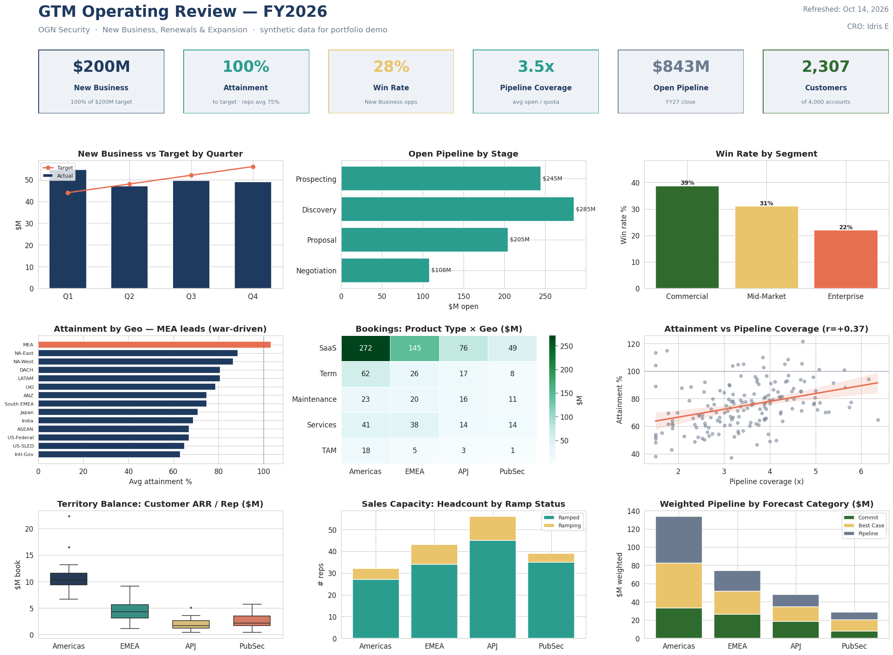

# GTM Operating Review — A Full-Funnel RevOps Analytics Pipeline

**RevOps / GTM analytics in Python (pandas · seaborn).** A single, refreshable
pipeline that reads Salesforce-style report exports and produces an executive
dashboard and a multi-section operating-review report — bookings and attainment,
pipeline and forecast, territory and capacity, and the measurable drivers of rep
performance.

> **Synthetic data, real analysis.** The dataset models a $750M-ARR enterprise
> security-SaaS business ("OGN Security"). The data is generated; the data model,
> the analysis, the pipeline, and the findings are real.



---

## The business, in one screen

| | |
|---|---|
| **New Business** | $200M booked — **100% of the $200M target** |
| **Avg rep attainment** | **75%** — on a quota book over-assigned at **1.24× target** |
| **New-Business win rate** | 28% overall (Commercial 39% → Enterprise 22%) |
| **Pipeline coverage** | 3.5× average open / quota |
| **Open pipeline** | $843M weighted into future quarters |
| **Install base** | 2,307 active customers across 4,000 accounts · 170 sellers |

## What the analysis found

**1 · The company hit plan, but the average seller sat at 75% of quota.**
That gap isn't underperformance — it's the signature of a deliberately
over-assigned book (1.24× target), the buffer that absorbs ramp and attrition.
Company attainment is never reported here without the rep-level distribution
behind it.

**2 · The top-performing geography runs against intuition: MEA led the company
at ~103% attainment** — above every Americas territory — on war-driven urgency
that lowers marketing friction and lifts the MEA win rate to ~52% vs ~28%
company-wide. The recommendation is to treat that surge as *exogenous* and not
permanently re-base quotas off a spike that may reverse.

**3 · Pipeline coverage is the dominant, most coachable driver of attainment**
(r = +0.37), ahead of XDR support (+0.24) and partner sourcing (+0.11). Raw deal
count shows no relationship — the null results are what make the finding credible.

**4 · Win rate degrades sharply up-market** (Commercial 39% → Mid-Market 31% →
Enterprise 22%), pointing to a qualification problem at the top of the funnel
rather than a closing one.

## How it maps to a RevOps / GTM Strategy & Ops role

Each section of the report is a real operating artifact: the actual-vs-target
cadence behind a weekly pipeline review, a bottoms-up forecast rolled up by
Commit / Best Case / Pipeline, a territory-balance and capacity model, and a
driver regression that tells leadership *which lever to pull*. The whole thing is
built on a relational (star-schema) data model — a bookings fact table joined to
account, product, geography, and sales-org dimensions — the same shape a real
Salesforce + planning stack produces.

---

## What's in here

```
gtm_report_pipeline.py          the whole pipeline — one file, top to bottom
gtm_dashboard.png               the one-page executive dashboard (above)
GTM_Revenue_Analytics_Report.pdf  the full multi-section operating-review report
data/                           the Salesforce-style CSV exports it reads
  ├─ fact_bookings.csv            one row per booked deal (New / Renewal / Expansion)
  ├─ opportunities.csv            one row per New-Business opp (stage, win/loss, forecast)
  ├─ accounts.csv                 segment, industry, ARR, territory owner
  ├─ dim_sales_org.csv            rep roster — hierarchy, quota, coverage, ramp, XDR, partner
  ├─ targets.csv                  the NBB plan by theater × quarter
  ├─ dim_geo.csv                  theater / geo reference
  └─ dim_product.csv              product family reference
```

## The stack

- **pandas** — loading, joining the star schema (`merge`), and aggregation
  (`groupby`, `pivot_table`, `corr`)
- **seaborn / matplotlib** — the dashboard grid and every chart (boxplot,
  regplot, heatmap, stacked bars)
- **playwright** *(optional)* — renders the HTML report to a polished PDF

## Run it

```bash
pip install pandas numpy matplotlib seaborn
python3 gtm_report_pipeline.py
```

By default it reads the `data/` folder next to the script and writes the
dashboard PNG and the report beside it. Point it at a different export folder with
environment variables:

```bash
GTM_DATA=/path/to/exports/ GTM_OUT=/path/to/output/ python3 gtm_report_pipeline.py
```

**Refreshing** is the whole point: drop freshly-exported CSVs (same file names)
into `data/` and re-run — the dashboard and the report both regenerate from
scratch, the way a scheduled report refresh would in production.

The PDF step needs Playwright. Without it the pipeline still builds the dashboard
and writes the report as HTML (open it and Print → Save as PDF). To enable the
automatic PDF:

```bash
pip install playwright && playwright install chromium
```

---

*Built by Idris E as a RevOps / GTM analytics case study. OGN Security is a
fictional company; all data is synthetic and seeded. Designed relationships
(e.g. coverage → attainment, the MEA uplift) exist to demonstrate the analysis.*
